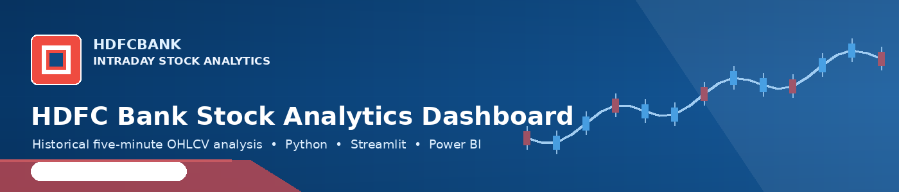
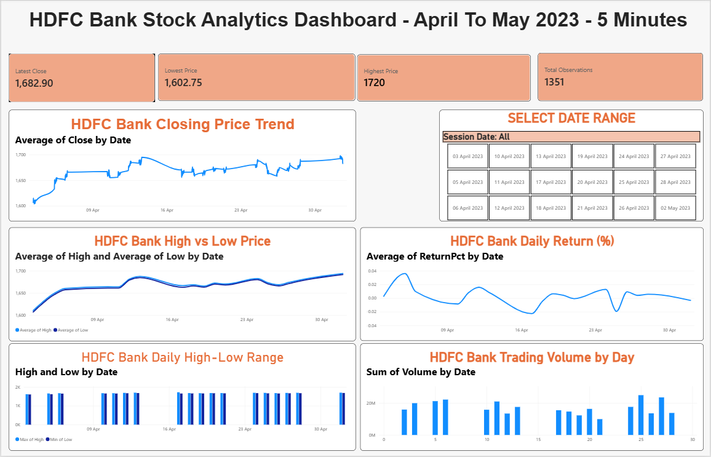
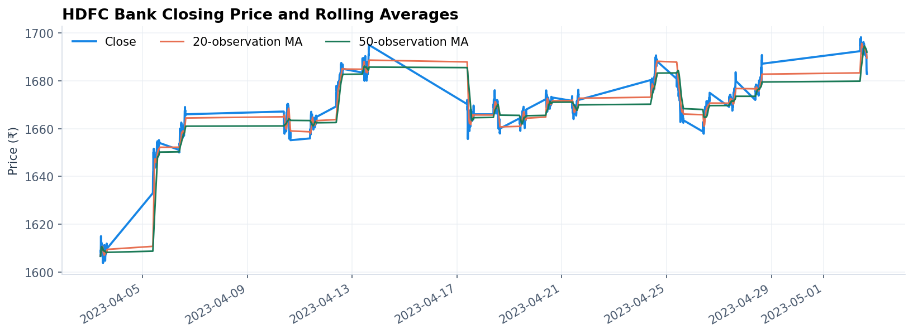
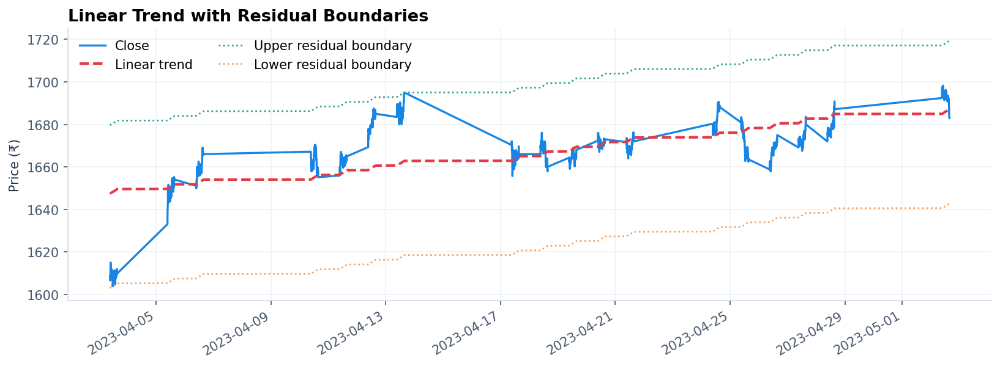
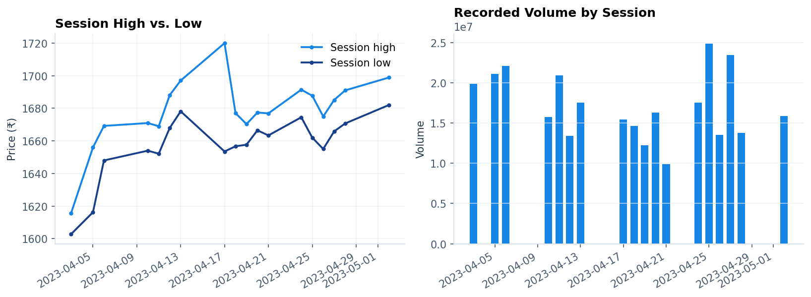
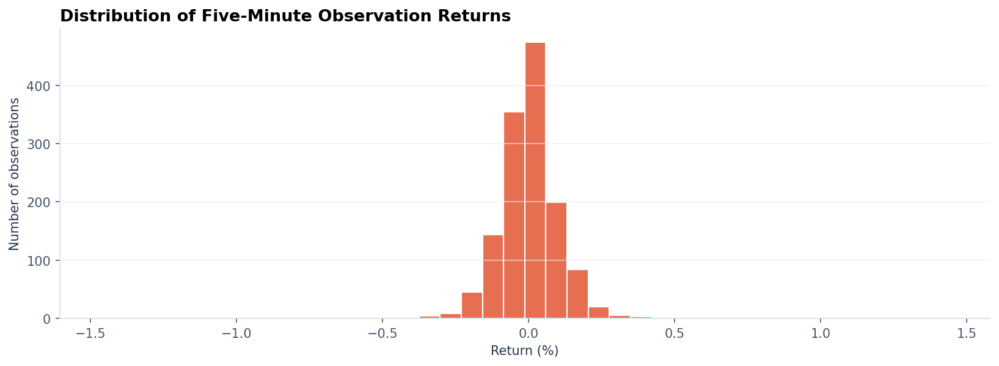

# 📈 HDFC Bank — Intraday Stock Analytics

<p align="center">
  
</p>

<p align="center">
  <strong>An interactive Streamlit and Power BI project for exploring historical 5-minute HDFCBANK OHLCV data.</strong><br>
  Price trends · Linear trend line · Moving averages · Volume · Returns · Session-level analysis
</p>

<p align="center">
  
  
  
  
  
  
</p>

> **Project scope:** This is an educational portfolio project based on a limited historical HDFC Bank dataset. It does not provide live market data, investment recommendations, trading signals, or financial advice.

## 📌 Project overview

I built this project to explore five-minute HDFC Bank stock observations and present the analysis through two tools: a Python-based Streamlit application and a Power BI report. The project includes data preparation, closing-price analysis, observation-based moving averages, a linear trend line, residual boundaries, session-level high/low comparisons, volume summaries, return analysis, interactive filters, and CSV export.

The Streamlit dashboard allows me to explore the historical dataset dynamically through a date-range filter and interactive Plotly charts. The Power BI report provides a second view of the same data through KPI cards, price and volume charts, a return chart, a high-low range chart, and a date slicer. The original Jupyter notebook is included so the trend-line exercise and moving-average analysis can be reviewed step by step.

## 🎯 Project objective

The objective is to turn timestamped OHLCV data into an understandable analytical workflow for exploring:

- Closing-price movement across five-minute observations
- Open, High, Low, and Close (OHLC) behaviour
- Linear trend direction across a selected historical range
- Residual-based upper and lower trend boundaries
- Rolling averages based on 20 and 50 observations
- Session-level high, low, closing price, and traded volume
- Observation-to-observation returns and session close-to-close returns
- Basic data-quality issues before visualization
- Interactive dashboard filtering and filtered-data export

**Workflow:** `Raw CSV → Cleaning → Validation → Derived metrics → Time-series analysis → Streamlit & Power BI dashboards`

## 📊 Dataset

The cleaned dataset in `data/HDFCBANK_Stock_Data.csv` contains **1,351 five-minute observations across 18 trading sessions**, from **3 April 2023 to 2 May 2023**.

| Dataset detail | Value |
|---|---:|
| Valid observations in supplied file | 1,351 |
| Trading sessions | 18 |
| First observation | 3 Apr 2023, 09:15 IST |
| Last observation | 2 May 2023, 15:30 IST |
| Interval | 5 minutes |
| Latest recorded close | ₹1,682.90 |
| Highest recorded high | ₹1,720.00 |
| Lowest recorded low | ₹1,602.75 |
| Average recorded five-minute volume | Approximately 228,351 |
| Total recorded volume across supplied observations | 308,502,252 |
| Instrument | HDFC Bank (`HDFCBANK`) |

These figures describe only the CSV included in this repository. They are historical values, not current market quotes, and can change in a dashboard when a date filter is applied.

### Expected columns

| Column | Meaning |
|---|---|
| `Date` | Timestamp of the five-minute observation, stored with the India time offset |
| `Open` | Opening price of the observation |
| `High` | Highest recorded price during the observation |
| `Low` | Lowest recorded price during the observation |
| `Close` | Closing price of the observation |
| `Volume` | Recorded trading volume for the observation |

The cleaned CSV contains the six source fields. Derived fields such as `SessionDate`, `ReturnPct`, `MA20_Observations`, and `MA50_Observations` are calculated when the Streamlit app loads the data.

## 🧹 Data cleaning and validation

The Python application loads the CSV, parses the `Date` field, converts OHLCV columns to numeric values, removes rows with missing required values, sorts observations chronologically, removes duplicate timestamps, and checks basic OHLC and volume constraints before plotting.

For the supplied cleaned CSV, the current quality check reports:

| Data-quality check | Result |
|---|---:|
| Missing required values | 0 |
| Duplicate timestamps | 0 |
| Invalid OHLC/volume rows | 0 |

The raw source file is retained as `data/StockDataHDFCBANK_raw.csv` for reference, while `data/HDFCBANK_Stock_Data.csv` is the standardized CSV used by the Streamlit application. If a replacement dataset is loaded, results depend on its contents and quality.

## ✨ Dashboard features

### 1. Streamlit dashboard

- **KPI cards:** Latest close, highest price, lowest price, total recorded volume, and observation count for the selected date range.
- **Date-range filtering:** Explore the observations between selected start and end dates.
- **Closing price and rolling averages:** Plot the closing price alongside 20-observation and 50-observation moving averages.
- **Linear trend line:** Fit a first-degree polynomial to the selected closing-price observations to summarize the historical slope.
- **Residual boundaries:** Plot upper and lower boundaries based on the most positive and negative residuals around the fitted line.
- **Session high and low:** Compare each session's maximum high and minimum low.
- **Volume by session:** Aggregate the recorded five-minute volume for each trading date.
- **Return distribution:** Explore the distribution of observation-to-observation percentage changes.
- **Session return comparison:** Compare session closing prices and close-to-close returns between available sessions.
- **Filtered data table:** Inspect filtered timestamped OHLCV rows and derived fields.
- **CSV export:** Download the filtered observations for further analysis.

### 2. Power BI dashboard

The included `.pbix` report was created in Power BI Desktop and contains:

- KPI cards for latest close, lowest price, highest price, and total observations
- HDFC Bank closing-price trend
- Average high versus average low price comparison
- Return chart based on the prepared `ReturnPct` field
- Daily high-low range chart
- Trading volume by date
- A `SessionDate` slicer for selecting dates

The report is supplied as a Power BI Desktop file. It is not a published Power BI Service report link. Depending on where the project folder is stored, Power BI may ask for the source CSV path to be reconnected.

### 3. Jupyter Notebook

`notebooks/HDFCBANK_Trend_Line_Analysis.ipynb` contains the original exploratory analysis workflow, including dataset loading, closing-price plotting, linear trend fitting, residual-based channel lines, and rolling-average visualizations. The notebook is included for transparency and for revisiting the analysis steps outside the dashboard.

## 🧮 Methodology and calculations

### Observation-based moving averages

The application calculates moving averages over the most recent 20 and 50 observations:

```text
MA(n) = Mean of the last n closing-price observations
```

These are **observation-based windows**, not 20-day or 50-day calendar averages. At the beginning of a series, the implementation uses the available observations through `min_periods=1`.

### Linear trend line

A first-degree polynomial is fitted to the closing prices in the selected range, using the observation order as the independent variable. The slope describes the direction and rate of the fitted line per observation.

The regression line is a descriptive summary of the selected historical series. It is not a forecast and should not be interpreted as a guaranteed future price path.

### Residual boundaries

Residuals are calculated as the actual closing price minus the fitted trend value. The app offsets the fitted line by the largest positive residual and the smallest negative residual to display descriptive upper and lower boundaries.

These boundaries are **not confidence intervals**, statistically estimated prediction intervals, or guaranteed support/resistance levels.

### Returns

Observation-to-observation return in the Streamlit app is calculated as:

```text
Return (%) = ((Current Close / Previous Close) - 1) × 100
```

The current implementation applies `pct_change()` to the chronologically sorted observation series, so the first observation of a new session is compared with the previous available observation in the file. The separate session return comparison calculates percentage change between consecutive session closing prices. These measures use different time intervals and should not be treated as interchangeable.

## 🖼️ Dashboard and analysis walkthrough

The first image below is the actual Power BI dashboard screenshot. The remaining images show analytical charts from the Python/Streamlit side of the project. These are kept separate so the README does not present Streamlit visuals as Power BI visuals or vice versa.

### . Power BI Dashboard — Working Demo

Watch the video below to see the Power BI dashboard in action, including interactive visuals, KPI cards, stock price trends, trading volume, and date filtering.

**Video file:** `Power BI Dashboard - Working Demo.mp4`

### 1. Power BI dashboard overview

The Power BI report brings together KPI cards, a closing-price trend, a high-low comparison, returns, a daily high-low range, trading volume, and the date selector.



### 2. Streamlit: closing price and moving averages

This Streamlit-side chart compares the recorded closing prices with 20-observation and 50-observation rolling averages.



### 3. Streamlit: linear trend and residual boundaries

The fitted trend line summarizes the overall direction of the selected historical series. Residual boundaries show the observed extremes around that fitted line and do not imply forecast confidence.



### 4. Streamlit: session high-low range and volume

Session-level aggregation helps compare the maximum high, minimum low, and total recorded volume for each available trading date.



### 5. Streamlit: five-minute return distribution

The histogram shows the distribution of observation-to-observation percentage returns in the supplied dataset.



## 🛠️ Technology stack

| Technology | Purpose |
|---|---|
| Python | Application logic and analytical calculations |
| Pandas | Data loading, cleaning, transformation, and session aggregation |
| NumPy | Numerical calculations and linear trend fitting |
| Plotly | Interactive charts in the Streamlit dashboard |
| Streamlit | Python web dashboard and interactive controls |
| Power BI Desktop | KPI cards, report visuals, and date slicer |
| Jupyter Notebook | Step-by-step exploratory trend-line analysis |
| CSV | Storage of historical OHLCV observations |

## 🗂️ Project structure

```text
HDFCBANK_Stock_Analytics_Project/
├── app.py
├── requirements.txt
├── README.md
├── LICENSE
├── .gitignore
├── assets/
│   ├── hdfcbank_header.png
│   ├── 01-powerbi-dashboard-overview.png
│   ├── 02-closing-price-moving-averages.png
│   ├── 03-linear-trend-residual-boundaries.png
│   ├── 04-session-high-low-volume.png
│   └── 05-five-minute-return-distribution.png
├── data/
│   ├── HDFCBANK_Stock_Data.csv
│   ├── StockDataHDFCBANK_raw.csv
│   └── DATA_DICTIONARY.md
├── notebooks/
│   └── HDFCBANK_Trend_Line_Analysis.ipynb
└── powerbi/
    ├── HDFCBANK_Stock_Analytics_Dashboard.pbix
    └── POWER_BI_NOTES.md
```

## 🚀 Run locally on Windows

### 1. Clone the repository

After creating the repository on GitHub, replace `YOUR-USERNAME` below with your GitHub username.

```cmd
git clone https://github.com/YOUR-USERNAME/HDFCBANK-Stock-Analytics-Project.git
cd HDFCBANK-Stock-Analytics-Project
```

### 2. Create and activate a virtual environment

```cmd
python -m venv .venv
.venv\Scripts\activate
```

### 3. Install the dependencies

```cmd
python -m pip install --upgrade pip
pip install -r requirements.txt
```

### 4. Start Streamlit

```cmd
python -m streamlit run app.py
```

Open the local URL printed in the terminal, usually `http://localhost:8501`.

### macOS / Linux

```bash
python3 -m venv .venv
source .venv/bin/activate
python -m pip install --upgrade pip
pip install -r requirements.txt
python -m streamlit run app.py
```

## 📊 Open the Power BI report

1. Install Power BI Desktop.
2. Open `powerbi/HDFCBANK_Stock_Analytics_Dashboard.pbix`.
3. If Power BI cannot find the original CSV path, reconnect the data source to `data/HDFCBANK_Stock_Data.csv` (or its absolute path on your computer).
4. Refresh the report and verify the field aggregations after reconnecting.
5. Use the `SessionDate` slicer to interact with the report.

Recommended aggregation logic: use an appropriate price aggregation for price trends, **Maximum High** and **Minimum Low** for the daily range, and **Sum of Volume** for session-level volume. Check KPI measure definitions if a card is expected to respond to the date slicer; a measure using `ALL()` may intentionally ignore the slicer.

## 📥 Data replacement and export

The Streamlit app uses the bundled `data/HDFCBANK_Stock_Data.csv` by default. To use a different file, replace the CSV while keeping the expected columns or adapt `app.py` to the new schema. The application currently reads the bundled file rather than exposing a CSV-upload control.

The **Explore filtered data** section shows the selected observations and provides a downloadable CSV containing the timestamp, OHLCV values, return, and moving-average fields. Verify the source, timestamp convention, units, and licensing before publishing or comparing replacement data.

## ⚠️ Analytical limitations

- The supplied dataset covers only 18 trading sessions, so it is a short historical sample rather than a long-term market study.
- The data is historical and is not refreshed automatically from a live source.
- Moving averages and trend lines summarize past observations; they do not predict future prices.
- Residual boundaries are descriptive and are not confidence intervals.
- Volume indicates recorded trading activity but does not explain why a price moved.
- The project does not include company fundamentals, market news, macroeconomic variables, transaction costs, taxes, or investor-specific circumstances.
- Return and volume summaries depend on the supplied data and selected date filter.
- The provided Power BI file may require source-path reconnection on another computer.

## 🔮 Possible future improvements

- Add validated technical indicators such as RSI, MACD, Bollinger Bands, and VWAP as optional descriptive tools.
- Add intraday time-of-day analysis and compare volume patterns across sessions.
- Add more historical data and compare HDFCBANK with a benchmark such as NIFTY Bank.
- Add reusable data-quality tests and unit tests for calculations.
- Add a full-page Streamlit application screenshot alongside the individual Streamlit chart images.
- Publish the Streamlit app online and link the deployment from this README.
- Improve the Power BI report with a dedicated calendar table, accessible date filtering, and documented DAX measures.

## 🎓 Learning outcomes

Through this project, I practiced loading and cleaning timestamped financial data, validating OHLCV relationships, building time-series visualizations, calculating observation-based moving averages and returns, fitting a linear trend line, deriving descriptive residual boundaries, aggregating metrics by trading session, creating interactive visualizations with Plotly and Streamlit, and presenting related analysis in Power BI.

## 👨‍💻 Author

Nadeem Ahamad

Data Analytics / Data Science project developed in association with Hackveda Solutions Private Limited Internship.

Focus: Intraday Stock Market Analysis · Time-Series Analytics · Financial Data Visualization · Python · Streamlit · Power BI 
GitHub: [@nadeemahamad007](https://github.com/nadeemahamad007)

**Project focus:** Intraday Stock Analysis · Time-Series Analytics · Financial Data Visualization · Python · Streamlit · Power BI

If this project is useful for learning financial-data analytics or dashboard development, feel free to ⭐ the repository.

---

**Disclaimer:** This project is for educational and portfolio purposes only. It summarizes historical HDFC Bank data and does not constitute financial, investment, trading, or tax advice. HDFC Bank is referenced only to identify the instrument represented in the dataset; this project is not an official HDFC Bank product.
